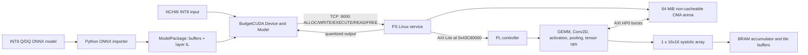
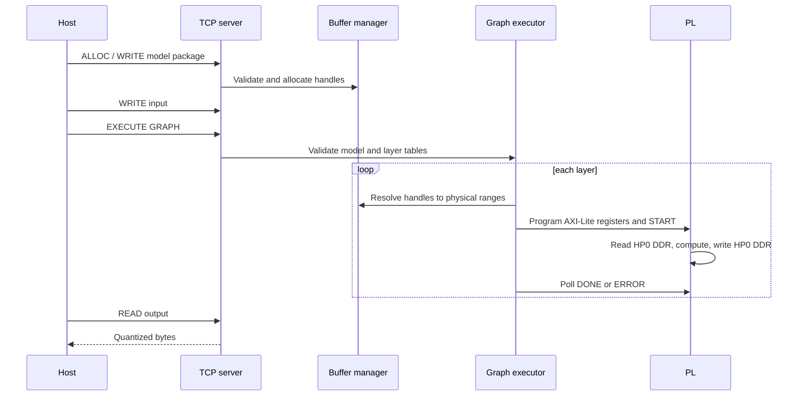

# BudgetCUDA Implementation and Architecture Guide

**Target:** PYNQ-Z2 (`xc7z020clg400-1`)  
**Deployment profile:** signed INT8 CNN inference, 100 MHz PL clock  
**Document status:** current implementation guide and maintenance reference, July 2026

Implementation history, rejected variants, and benchmark discoveries are
tracked in [IMPLEMENTATION_TIMELINE.md](IMPLEMENTATION_TIMELINE.md). Update the
timeline in the same commit as every architectural change or mass test.

This document explains how to reproduce BudgetCUDA, deploy a model, and safely
change the system. It describes the current PYNQ-Z2 implementation, not every
idea retained in the design history. The deployable image contains one 16x16
systolic array. The source-level eight-array cluster is a scalability prototype
for a larger FPGA and must not be mistaken for the board configuration.

## 1. Purpose and Source of Truth

BudgetCUDA is a small inference accelerator stack spanning:

1. a Python host library and ONNX importer;
2. a versioned TCP command protocol and graph intermediate language (IL);
3. a Linux service on the Zynq processing system (PS);
4. an AXI-Lite control plane and an AXI HP0 DDR data plane;
5. pipelined programmable logic (PL) operators for quantized CNNs; and
6. software, RTL, full-system, and board-level verification.

When two files disagree, use this order of authority:

1. [final_bitstream_sources.tcl](hardware/vivado/final_bitstream_sources.tcl)
   defines the RTL that enters the deployable image.
2. [bcuda_protocol.h](firmware/include/bcuda_protocol.h) and
   [dtypes.py](budgetcuda/dtypes.py) define the shared protocol and IL numbers.
3. [bcuda_axi_dma.h](firmware/include/bcuda_axi_dma.h) and
   [bcuda_ddr_gemm_register_map.md](hardware/docs/bcuda_ddr_gemm_register_map.md)
   define the PS-to-PL register contract.
4. Active source and focused golden tests define behavior.
5. Generated reports record the last build; regenerate them after RTL or
   constraint changes.
6. `future_prototypes/`, `deprecated/`, generated Vivado projects, and older
   design descriptions are historical context only.

## 2. System Overview



The host owns model parsing, validation, static memory planning, upload, and
inference scheduling. The PS owns connection handling, buffer handles, physical
address translation, graph dispatch, and PL launch sequencing. The PL owns the
high-volume arithmetic and DDR movement for supported operators.

## 3. Current Product Boundary

### 3.1 Implemented deployment path

- Signed INT8 activations and weights; INT32 bias and accumulation.
- ONNX Q/DQ import for the constrained production profile described below.
- Persistent model upload: weights, scale parameters, and IL are loaded once.
- Repeated inference by writing only the input and executing the cached IL.
- Tiled GEMM with zero padding at partial M, N, and K boundaries.
- Direct Conv2D lowering in PL; no full im2col tensor is materialized in DDR.
- PL bias preload, fixed-point requantization, ReLU, and power-of-two LeakyReLU.
- MaxPool, AveragePool, GlobalAveragePool, nearest-neighbor upsample, concat,
  and shape-only reshape/flatten execution paths.
- Real PS/PL path through GP0 control and HP0 DDR access.
- Ethernet host API with configurable address and port.

### 3.2 Deliberate constraints

- The deployed PYNQ-Z2 image uses **one** 16x16 array. `ARRAY_COUNT` must be 1.
- A and B GEMM operands are INT8; the direct GEMM result is INT32.
- PL-visible physical addresses are 32-bit and must satisfy operator alignment.
- The stable service arena is 64 MiB. The kernel currently reserves 128 MiB
  CMA, but the service intentionally does not claim all of it.
- Quantization is signed, per-tensor, symmetric for inputs and weights, with
  zero point 0. Per-channel scales and arbitrary asymmetric input zero points
  are outside the deployed profile.
- Requantization truncates after the fixed-point multiply and arithmetic shift,
  then adds the output zero point and saturates to INT8. It does not implement
  ONNX Runtime's general rounding policy.
- Detection decode and NMS have protocol op numbers but are not part of the
  validated PL CNN path. Run them on the host until explicitly implemented and
  verified.
- This is an inference system. Training remains a PyTorch responsibility.

## Part I: Implementation Guide

## 4. Repository Layout

| Path | Responsibility |
| --- | --- |
| `budgetcuda/` | Python tensors, protocol client, graph builder, compiler, ONNX importer, mock backend, and PYNQ helpers |
| `firmware/include/` | C ABI, protocol, buffer manager, graph runtime, and register definitions |
| `firmware/src/` | TCP server, command dispatch, CMA allocator, graph executor, and PL launch driver |
| `firmware/linux/` | Native build script and systemd service |
| `hardware/rtl/` | Synthesizable PL modules |
| `hardware/sim/` | SystemVerilog testbenches |
| `hardware/vivado/` | Project, wrapper, simulation, implementation, and export scripts |
| `hardware/docs/` | Register and memory-I/O contracts |
| `tests/host/` | Python host and compiler tests |
| `tests/firmware/` | C firmware tests driven from Python |
| `tests/hardware/` | Golden-trace generators and board diagnostics |
| `train_model/` | Fruit model training, QAT, quantized export, and checkpoints |
| `future_prototypes/` | Designs not used by the deployable image |
| `deprecated/` | Retired paths and single-beat tests |

Do not add a module to the bitstream merely by placing it in `hardware/rtl`.
Add it to `final_rtl_files` in `final_bitstream_sources.tcl`, instantiate it from
the active top, and verify that synthesis did not trim it.

## 5. Development Prerequisites

### 5.1 Host workstation

- Windows PowerShell, Python virtual environment, and Git.
- Xilinx Vivado 2024.2 with Zynq-7000 device support.
- Python packages used by the active flow: `numpy`, `onnx`, `onnxruntime`,
  `torch`, `torchvision`, `Pillow`, `pytest`, `tqdm`, and `scikit-learn`.
- PuTTY `plink`/`pscp` or an equivalent SSH/SCP client for board deployment.
- Optional FTDI D2XX library for UART recovery through
  `tests/hardware/pynq_ftdi_uart.py`.

The project virtual environment is at the repository root:

```powershell
& .\.venv\Scripts\Activate.ps1
python -c "import torch, onnx, onnxruntime, numpy; print('environment ready')"
```

### 5.2 Board

- PYNQ-Z2 with its normal Linux image and `/dev/xlnk` legacy CMA driver.
- Ethernet connectivity. The default endpoint is `192.168.2.99:9000`.
- SSH user `xilinx`; privileged deployment commands require root access.
- FCLK0 set to 100 MHz before programming the timing-closed image.

## 6. Build the Verification Baseline First

Always establish software correctness before opening Vivado.

```powershell
& .\.venv\Scripts\python.exe -m pytest FPGA\tests\host -q
& .\.venv\Scripts\python.exe -m pytest FPGA\tests\firmware -q
```

Generate golden data only when the intended arithmetic contract changes:

```powershell
& .\.venv\Scripts\python.exe FPGA\tests\hardware\create_gemm_golden_trace.py
& .\.venv\Scripts\python.exe FPGA\tests\hardware\create_systolic_golden_trace.py
& .\.venv\Scripts\python.exe FPGA\tests\hardware\create_tileloader_golden_trace.py
& .\.venv\Scripts\python.exe FPGA\tests\hardware\create_tilewriter_golden_trace.py
& .\.venv\Scripts\python.exe FPGA\tests\hardware\create_accumulator_golden_trace.py
& .\.venv\Scripts\python.exe FPGA\tests\hardware\create_double_buffer_golden_trace.py
```

Golden generators are executable specifications, not a mechanism for making a
failing RTL test green. Review changed traces against the quantization and
padding contracts before committing them.

## 7. Train and Export a Supported Model

The reference profile uses PyTorch QAT with signed `qint8`, per-tensor symmetric
scales, and zero point 0. The fruit classifier is the maintained example.

Fine-tune:

```powershell
Set-Location FPGA\train_model
& ..\..\.venv\Scripts\python.exe train_budgetcuda_qat.py `
  --epochs 10 --device auto --output-dir models\fruit3_budgetcuda_qat
```

Export the canonical Q/DQ ONNX model:

```powershell
& ..\..\.venv\Scripts\python.exe export_budgetcuda_int8_onnx.py `
  --checkpoint models\fruit3_budgetcuda_qat\best_budgetcuda_qat_fakequant.pt `
  --output models\fruit3_budgetcuda_qat\fruit3_budgetcuda_int8.onnx
```

The custom exporter exists because a stock PyTorch export may introduce
unsigned image quantization, conversion nodes, or quantization forms that do
not match the signed PL datapath. A supported model should satisfy:

- statically known tensor shapes;
- NCHW convolution and pooling tensors;
- INT8 weight initializers and INT32 bias initializers;
- scalar, positive, per-tensor scales;
- symmetric Conv padding written explicitly;
- LeakyReLU alpha equal to `2^-N`, where `N` is 0 through 7;
- Gemm `transA=0`, `alpha=1`, and `beta=1`; and
- no unsupported graph branch or dynamic shape operation.

## 8. Import and Validate ONNX

The importer in [onnx_import.py](budgetcuda/onnx_import.py) recognizes the
project's direct quantized subset and canonical Q/DQ patterns. It validates
shape, dtype, scale, zero-point, bias, and layout constraints while producing a
`ModelPackage`.

```python
from budgetcuda.onnx_import import import_onnx_model

package = import_onnx_model("model_int8.onnx")
print(len(package.layers), len(package.buffers))
```

The supported importer surface includes:

- `QLinearConv`;
- Q/DQ `Conv` with optional INT32 bias;
- `Relu` and restricted `LeakyRelu`;
- `MaxPool`, `AveragePool`, and `GlobalAveragePool`;
- `Flatten` and shape-only `Reshape`;
- `MatMul`; and
- restricted biased/transposed `Gemm` forms handled by the Q/DQ lowering.

Importer acceptance does not by itself prove board support. Every emitted
`OpType` must also have a firmware dispatch case, a correct PL or intentional
PS implementation, and end-to-end tests.

## 9. Simulate the PL

Run the focused final-top test first:

```powershell
& 'C:\Xilinx\Vivado\2024.2\bin\vivado.bat' -mode batch `
  -source 'C:\python_projects\capstone_project\FPGA\hardware\vivado\run_final_top_sim.tcl'
```

Then run the active regression suite:

```powershell
& 'C:\Xilinx\Vivado\2024.2\bin\vivado.bat' -mode batch `
  -source 'C:\python_projects\capstone_project\FPGA\hardware\vivado\run_hardware_tests.tcl'
```

The suite covers PE arithmetic, tile loading and writing, the parameterized
cluster, tensor operators, pooling, requantization, burst memory I/O, MMIO,
accumulators, the controller, the 16x16 array, and the final top. A passing test
must print `golden trace passed`.

Pipeline changes normally alter latency without altering values. Update a
testbench's ready/valid or done-cycle expectations when adding stages; do not
weaken its data, address, byte-strobe, ordering, or transaction-count checks.

If Vivado reports a locked work library, first confirm that no `xvlog`, `xelab`,
`xsim`, or Vivado process is active. A project-local `.Xil` or dedicated XSim
work directory may then be removed and regenerated. Never delete shared build
state while a tool process is alive.

## 10. Build the PYNQ-Z2 Image

The canonical build regenerates the PS/PL block design, resets stale runs,
synthesizes, implements, checks timing, and exports `.bit`, `.bin`, and `.xsa`:

```powershell
& 'C:\Xilinx\Vivado\2024.2\bin\vivado.bat' -mode batch `
  -source 'C:\python_projects\capstone_project\FPGA\hardware\vivado\build_pynq_z2_bitstream.tcl'
```

Expected artifacts appear in `FPGA/hardware/`:

- `bcuda_pynq_z2.bit`;
- `bcuda_pynq_z2.bin`;
- `bcuda_pynq_z2.xsa`;
- `pynq_z2_utilization_synth.rpt`;
- `pynq_z2_utilization_impl.rpt`; and
- `pynq_z2_timing_impl.rpt`.

The build runs post-route `phys_opt_design -directive AggressiveExplore` when
routed WNS is negative. The last validated image met 100 MHz with WNS
`+0.001 ns`, TNS `0`, and WHS `+0.019 ns`. These are build results, not
guarantees: always inspect the newly generated timing report.

Release criteria are:

- zero DRC errors;
- WNS and WHS greater than or equal to zero;
- no unconstrained functional clocks or I/O paths;
- the active top is `bcuda_tiled_systolic_ddr_top` through the generated PS/PL
  wrapper;
- DSP, BRAM, LUT, and routing utilization fit the `xc7z020`; and
- no required operator is optimized away.

## 11. Build and Install the PS Service

Copy `firmware/` to `/home/xilinx/budgetcuda-fw` on the board, then build
natively:

```sh
cd /home/xilinx/budgetcuda-fw
sh linux/build_server.sh /home/xilinx/budgetcuda-fw/budgetcuda-server
sudo cp linux/budgetcuda.service /etc/systemd/system/budgetcuda.service
sudo systemctl daemon-reload
sudo systemctl enable budgetcuda.service
```

The checked-in service launches:

```text
/home/xilinx/budgetcuda-fw/budgetcuda-server 9000 64
```

That means TCP port 9000 and a 64 MiB model/buffer arena. Whenever the protocol,
IL, register map, or operator dispatch changes, deploy the matching daemon and
bitstream as one release. A stale daemon can produce plausible but incorrect
results; an observed AveragePool result once equaled MaxPool because the board
was still running an older dispatcher.

## 12. Program the Board

For FPGA-manager deployment, convert/export the FPGA-manager-compatible binary,
copy it below `/lib/firmware`, set FCLK0 to the implementation frequency, and
request programming:

```sh
sudo cp bcuda_pynq_z2_fpga_manager.bin /lib/firmware/
sudo sh -c 'echo bcuda_pynq_z2_fpga_manager.bin > /sys/class/fpga_manager/fpga0/firmware'
cat /sys/class/fpga_manager/fpga0/state
sudo systemctl restart budgetcuda.service
```

The state must read `operating`. Confirm the live FCLK0 divisor before loading
the image. For 90.91 MHz the register must be `0x00100b00` (divisors 1 and 11),
not `0x00200b00`, which is only 45.45 MHz. `tests/hardware/pynq_fclk0.py` and the helper in
`budgetcuda/pynq.py` implement the validated divider programming sequence.

Do not add a large CMA override to `/boot/uEnv.txt` on the current image. A
tested `cma=288M` override prevented normal boot. The board was recovered over
FTDI UART by interrupting U-Boot and removing `uEnv.txt` from the FAT boot
partition. Keep the stable 128 MiB kernel reservation and 64 MiB service arena
unless a new image and boot configuration are validated separately.

## 13. Run an End-to-End Model

This section is the practical host-side path from an exported ONNX file to a
prediction returned by the FPGA. The normal application lifecycle is:

```text
prepare board -> import ONNX -> inspect package -> create Device
-> upload model once -> quantize/write each input -> execute cached graph
-> read/dequantize output -> repeat -> close model
```

### 13.1 Make the Host Package Importable

`budgetcuda` currently lives directly below `FPGA/`; it is not installed as a
wheel. From the repository root, add `FPGA` to `PYTHONPATH` for the current
PowerShell session:

```powershell
& .\.venv\Scripts\Activate.ps1
$env:PYTHONPATH = "$PWD\FPGA"
python -c "from budgetcuda import Device, import_onnx_model; print('BudgetCUDA host ready')"
```

Applications outside this repository should add the absolute `FPGA` directory
to their environment or package the module before deployment. Do not add
`FPGA/budgetcuda` itself: Python needs the directory that contains the package.

The host endpoint can be explicit in code or configured through environment
variables:

```powershell
$env:BCUDA_BOARD_IP = "192.168.2.99"
$env:BCUDA_BOARD_PORT = "9000"
$env:BCUDA_SOCKET_TIMEOUT = "300"
```

`BUDGETCUDA_BOARD_IP` and `BUDGETCUDA_BOARD_PORT` are accepted as compatibility
aliases. Explicit `Device(address, port, timeout)` arguments take precedence.
The default timeout is only 5 seconds, which is too short for some full CNN
operations, so applications should select a measured upper bound.

### 13.2 Check Board Readiness

Before allocating model buffers, separate network, service, PL, and clock
checks. From Windows:

```powershell
Test-Connection 192.168.2.99 -Count 2
Test-NetConnection 192.168.2.99 -Port 9000
```

On the board:

```sh
cat /sys/class/fpga_manager/fpga0/state
systemctl is-active budgetcuda.service
systemctl status budgetcuda.service --no-pager
ss -ltn | grep ':9000'
```

The expected FPGA manager state is `operating`, the service is `active`, and
port 9000 is listening. Constructing `Device()` does **not** establish a TCP
connection. Connectivity is first exercised by an operation such as `ALLOC`,
normally during `load_model()`.

### 13.3 Import and Inspect the Model Package

Importing is entirely local. It validates ONNX and lowers it into buffers and
layer descriptors; it does not contact or allocate anything on the board.

```python
from pathlib import Path
from budgetcuda import import_onnx_model

model_path = Path("FPGA/train_model/models/fruit3_budgetcuda_qat_smoke/fruit3_budgetcuda_int8.onnx")
package = import_onnx_model(model_path)

input_spec = package.buffers[package.input_index]
output_spec = package.buffers[package.output_index]
descriptor_bytes = len(package.serialize_descriptor())
buffer_bytes = sum(buffer.size_bytes for buffer in package.buffers)

print(f"layers: {len(package.layers)}")
print(f"buffers: {len(package.buffers)}")
print(f"input: {input_spec.name} {input_spec.shape} {input_spec.dtype.name} {input_spec.layout.name}")
print(f"output: {output_spec.name} {output_spec.shape} {output_spec.dtype.name} {output_spec.layout.name}")
print(f"logical buffer bytes: {buffer_bytes}")
print(f"descriptor bytes: {descriptor_bytes}")

for index, layer in enumerate(package.layers):
    print(index, layer.op_type.name, "input", layer.input0, "output", layer.output)
```

Inspect this before board upload. In particular:

- the runtime input must be INT8 and have the expected static shape;
- buffer memory plus descriptors and allocator alignment must fit the 64 MiB
  daemon arena;
- every layer's `OpType` must be supported by the deployed daemon and PL image;
- the output is the quantized tensor immediately before a terminal ONNX
  `DequantizeLinear`, not necessarily the ONNX graph's floating dtype; and
- one imported package currently has exactly one runtime input and one output.

`buffer_bytes` is a useful lower bound, not an exact arena-consumption figure.
Each remote allocation is aligned, and the daemon also owns allocation
metadata.

### 13.4 Understand What `load_model()` Does

Create the network device and upload the package:

```python
from budgetcuda import Device
from budgetcuda.onnx_import import import_onnx_model

package = import_onnx_model("model_int8.onnx")
device = Device("192.168.2.99", 9000, timeout=300.0)
model = device.load_model(package)
try:
    output0 = model.run(input0_int8)
    output1 = model.run(input1_int8)
finally:
    model.close()
```

`load_model()` performs the following protocol sequence:

1. send `ALLOC` for every package buffer;
2. send `WRITE` for each constant weight, bias, or scale buffer;
3. serialize the model descriptor using the returned board buffer IDs;
4. allocate a descriptor buffer and upload the IL; and
5. return a `Model` containing persistent remote handles.

If upload fails partway through, `upload_model()` attempts to release everything
it already allocated. Model weights are not reloaded for each inference. Keep
the returned `Model` alive for the entire inference interval or application
session.

The current socket transport opens one TCP connection per command. Persistent
model state lives in the board service's buffer arena, not in a persistent TCP
socket. Therefore a transient connection can be retried at the application
level, but an interrupted `EXECUTE` must not be blindly replayed until the board
status and output ownership are known.

### 13.5 Prepare the INT8 Input

BudgetCUDA does not automatically resize images, normalize channels, or quantize
floating inputs. Preprocessing must match training exactly, and the final host
array must match the imported input shape, order, and dtype.

For an ONNX Q/DQ model, the input quantization equation is:

```text
q = clamp(round(real_value / input_scale) + input_zero_point, -128, 127)
```

The deployed profile normally has `input_zero_point = 0`. BudgetCUDA reads the
scalar parameters from the Q/DQ graph and exposes shape-preserving conversion
methods:

```python
from budgetcuda import onnx_qdq_params

qdq = onnx_qdq_params(model_path)
print(qdq.input_name, qdq.input.scale, qdq.input.zero_point)
input_int8 = qdq.input.quantize(input_float)
```

For the reference fruit classifier, training used RGB, resize to 64x64 with
antialiasing, conversion to `[0, 1]`, then NCHW layout. The host helper performs
those steps and derives the target dimensions from `input_spec.shape`:

```python
from budgetcuda import load_quantized_image

input_int8 = load_quantized_image(
    "apple.jpg",
    input_spec.shape,
    qdq.input,
    layout=input_spec.layout,
)
```

For models trained with channel normalization, supply the same parameters used
during training, for example `mean=(0.485, 0.456, 0.406)` and
`std=(0.229, 0.224, 0.225)`. The helper intentionally does not guess these
values. Non-image inputs should call `qdq.input.quantize(values)` directly.

Check before every run during integration:

```python
if input_int8.dtype != np.int8 or input_int8.shape != input_spec.shape:
    raise ValueError(
        f"expected {input_spec.shape} INT8 input, got {input_int8.shape} {input_int8.dtype}"
    )
```

Passing float32 to `Model.run()` is not supported merely because NumPy can
serialize it. `Device.write()` serializes the supplied array's native bytes; it
does not cast them to the remote tensor dtype. A float array would therefore
have the wrong byte count and representation.

### 13.6 Execute Repeated Inference

`Model.run(input)` is synchronous and performs exactly three high-level steps:

1. `WRITE` the complete input tensor to its persistent board buffer;
2. `EXECUTE GRAPH`, causing the PS to walk the cached IL and launch each layer;
3. `READ` the complete output tensor and return a NumPy array.

```python
import time

board_model = device.load_model(package)
try:
    latencies = []
    for input_int8 in inference_inputs:
        started = time.perf_counter()
        output_int8 = board_model.run(input_int8)
        latencies.append(time.perf_counter() - started)
finally:
    board_model.close()
```

The returned array is shaped according to the output `HostBuffer` and normally
has dtype `numpy.int8`. End-to-end latency measured around `run()` includes
input network transfer, PS dispatch, all PL layers, output transfer, and protocol
overhead. It is not pure accelerator-kernel time.

The current API is synchronous. Do not call the same loaded `Model` concurrently
from multiple threads: its input, output, activation arenas, and workspace are
shared mutable buffers. Use explicit application serialization. Multiple model
instances also compete for the fixed arena and the single PL engine.

### 13.7 Interpret and Dequantize the Output

When the ONNX graph ends with `DequantizeLinear`, BudgetCUDA returns its INT8
input. Recover the floating value with:

```text
real_value = (q - output_zero_point) * output_scale
```

```python
qdq = onnx_qdq_params(model_path)
output_float = qdq.output.dequantize(output_int8)
predicted_index = int(np.argmax(output_int8.reshape(-1)))
```

For one common scale and zero point, `argmax` is identical before and after
dequantization. Read class names from the exported adjacent JSON manifest
instead of embedding an order that can drift from training:

```python
import json

manifest = json.loads(model_path.with_suffix(".json").read_text(encoding="utf-8"))
class_name = manifest["class_names"][predicted_index]
```

### 13.8 Complete Fruit-Classifier Application

This example combines import, Q/DQ extraction, preprocessing, persistent model
upload, execution, output conversion, and cleanup:

```python
from pathlib import Path
import json

import numpy as np

from budgetcuda import (
    Device,
    import_onnx_model,
    load_quantized_image,
    onnx_qdq_params,
)

MODEL_PATH = Path(
    "FPGA/train_model/models/fruit3_budgetcuda_qat_smoke/fruit3_budgetcuda_int8.onnx"
)
IMAGE_PATH = Path("apple.jpg")

package = import_onnx_model(MODEL_PATH)
input_spec = package.buffers[package.input_index]
qdq = onnx_qdq_params(MODEL_PATH)
input_int8 = load_quantized_image(
    IMAGE_PATH,
    input_spec.shape,
    qdq.input,
    layout=input_spec.layout,
)

if input_int8.shape != input_spec.shape:
    raise RuntimeError(f"input shape {input_int8.shape} != model shape {input_spec.shape}")

device = Device("192.168.2.99", 9000, timeout=300.0)
model = device.load_model(package)
try:
    logits_int8 = model.run(input_int8)
finally:
    model.close()

logits = qdq.output.dequantize(logits_int8)
class_index = int(np.argmax(logits.reshape(-1)))
manifest = json.loads(MODEL_PATH.with_suffix(".json").read_text(encoding="utf-8"))
print({
    "class_index": class_index,
    "class_name": manifest["class_names"][class_index],
    "int8_logits": logits_int8.reshape(-1).tolist(),
    "float_logits": logits.reshape(-1).tolist(),
})
```

For interval-based production inference, move everything through
`device.load_model(package)` outside the periodic loop. Only preprocessing and
`model.run()` belong in each interval. Reload after a daemon restart, board
reboot, bitstream reprogramming that restarts the service, or any event that
invalidates remote buffer handles.

### 13.9 Compare FPGA, Mock, and ONNX Runtime

Use three references for different questions:

- `Device.mock()` checks exact BudgetCUDA integer semantics.
- The FPGA must match `Device.mock()` bit for bit.
- ONNX Runtime checks the exported graph's external semantics. Small value
  differences can occur because BudgetCUDA truncates fixed-point stages while
  ONNX `QuantizeLinear` rounds; classification and a documented LSB tolerance
  are used in addition to exact FPGA/mock equality.

```python
mock_model = Device.mock().load_model(package)
board_model = device.load_model(package)
try:
    expected = mock_model.run(input_int8)
    actual = board_model.run(input_int8)
    np.testing.assert_array_equal(actual, expected)
finally:
    board_model.close()
    mock_model.close()
```

For a first deployment, use the maintained diagnostic rather than writing this
comparison from scratch:

```powershell
python FPGA\tests\hardware\pynq_full_cnn_inference.py `
  --model FPGA\train_model\models\fruit3_budgetcuda_qat_smoke\fruit3_budgetcuda_int8.onnx `
  --address 192.168.2.99 --port 9000 --timeout 300 --diagnose-layers
```

Layer-prefix diagnosis repeatedly uploads graph prefixes and is intentionally
slow. It is for locating the first incorrect layer, not measuring production
latency.

### 13.10 Cleanup and Failure Handling

Always put `model.close()` in `finally`. It sends `FREE` for the descriptor and
all model buffers. The `Device` itself currently owns no persistent socket and
has no required close operation.

Important failure cases:

- `OnnxImportError`: the model is outside the supported static INT8 profile;
  fix export/lowering rather than attempting board execution.
- `ProtocolError: Cannot reach`: check IP, port, Ethernet, service, and timeout.
- Protocol status `OUT_OF_MEMORY`: close unused models, confirm the 64 MiB arena,
  and inspect package size and alignment overhead.
- Protocol status `EXECUTION_FAILED`: inspect service logs, PL status, register
  packing, and the first failing graph prefix.
- Lost connection during upload: `upload_model()` cleans up when it receives an
  exception, but a board or daemon failure can prevent the cleanup commands.
  Restarting the daemon recreates its arena state; reload the entire model.
- Lost connection after a successful upload: handles are meaningful only to the
  same running daemon instance. Never persist them across service or board
  restarts.
- Shape/dtype mismatch: validate the NumPy array before `run()`; the current
  byte serializer does not perform semantic casting.

After an unexpected exception, do not reuse a model whose execution state is
unknown. Close it if the service is reachable; otherwise restore the daemon and
upload a fresh package.

### 13.11 Maintained Board Commands

Use these progressively stronger checks:

```powershell
python FPGA\tests\hardware\pynq_mmio_smoke.py
python FPGA\tests\hardware\pynq_hp0_gemm_smoke.py
python FPGA\tests\hardware\pynq_hp0_postop_smoke.py
python FPGA\tests\hardware\pynq_full_cnn_inference.py --diagnose-layers
python FPGA\tests\hardware\pynq_cnn_load_test.py --iterations 100
python FPGA\tests\hardware\pynq_fruit_accuracy.py --board-per-class 100
```

The layer diagnostic executes every graph prefix and compares it exactly with
`Device.mock()`. It is the fastest way to locate the first divergent operator.
The ONNX Runtime comparison may allow a small LSB tolerance because BudgetCUDA
intentionally truncates while general runtimes may round.

### 13.12 Host API Reference and Low-Level Use

Most applications need only `import_onnx_model`, `Device.load_model`,
`Model.run`, and `Model.close`. The lower-level methods are useful for operator
bring-up and diagnostics:

| API | Host action | Board protocol action |
| --- | --- | --- |
| `Device(address, port, timeout)` | Configure an endpoint | None until first command |
| `Device.mock()` | Construct an in-process semantic reference | No network or FPGA |
| `device.alloc(shape, dtype, layout, usage)` | Create a `Tensor` handle | `ALLOC` |
| `device.write(tensor, values, offset_bytes)` | Serialize C-order bytes | `WRITE` |
| `device.read(tensor, offset_bytes, nbytes)` | Return shaped NumPy data for a full read | `READ` |
| `device.execute_gemm(A, B, C, M, N, K)` | Pack a standalone GEMM descriptor | `EXECUTE GEMM` |
| `device.execute_graph(desc, input, output)` | Pack a graph execution descriptor | `EXECUTE GRAPH` |
| `device.free(tensor)` | Invalidate an application-owned remote allocation | `FREE` |
| `device.load_model(package)` | Allocate and upload an entire package | Multiple commands |
| `model.run(input)` | Synchronous input-to-output inference | `WRITE`, `EXECUTE`, `READ` |
| `model.close()` | Release package allocations | One `FREE` per allocation |

`Tensor` is metadata: buffer ID, shape, dtype, layout, byte size, and owning
device. It does not contain a host-side copy of board memory. A full
`device.read()` returns a shaped NumPy array; a partial byte-range read returns
an unsigned byte array because it may not represent a complete typed tensor.

The following standalone GEMM bypasses ONNX and graph IL. It is useful for
checking the host protocol, PS buffer manager, register driver, HP0 memory path,
and systolic array in one small test:

```python
import numpy as np
from budgetcuda import Device

M, N, K = 19, 23, 17  # intentionally not divisible by the 16x16 tile size
rng = np.random.default_rng(2026)
a_values = rng.integers(-8, 9, size=(M, K), dtype=np.int8)
b_values = rng.integers(-8, 9, size=(K, N), dtype=np.int8)
expected = a_values.astype(np.int32) @ b_values.astype(np.int32)

device = Device("192.168.2.99", 9000, timeout=60.0)
a = device.alloc((M, K), "int8", layout="row_major", usage="activation")
b = device.alloc((K, N), "int8", layout="row_major", usage="weight")
c = device.alloc((M, N), "int32", layout="row_major", usage="output")
try:
    device.write(a, a_values)
    device.write(b, b_values)
    response = device.execute_gemm(a, b, c, M, N, K)
    actual = device.read(c)
    np.testing.assert_array_equal(actual, expected)
    print("GEMM passed", response.fields)
finally:
    for tensor in (c, b, a):
        try:
            device.free(tensor)
        except Exception:
            pass
```

Irregular dimensions deliberately exercise partial tiles and zero padding.
The application allocates the logical M-by-K, K-by-N, and M-by-N extents; the
controller is responsible for treating out-of-range tile lanes as zero and for
writing only valid output elements.

Low-level ownership rules are strict:

- free each allocation exactly once;
- do not use a `Tensor` after `free`;
- do not mix tensors from different `Device` or daemon instances;
- preserve row-major or NCHW layout expected by the selected operation;
- use NumPy arrays whose dtype matches the remote tensor;
- keep offsets and lengths within `Tensor.size_bytes`; and
- wait for synchronous `execute` completion before reading or freeing operands.

### 13.13 Per-Layer Diagnostics

`budgetcuda.diagnostics` instruments one graph execution without changing the
result of ordinary `Model.run()` calls. Configure the requested reports, pass
the settings object to `run`, and receive a `DiagnosticResult` containing both
the model output and a parsed `RunDiagnostics` report:

```python
from budgetcuda import DiagnosticsSettings

settings = DiagnosticsSettings(
    timing=True,
    memory=True,
    operations=True,
    utilization=True,
    clock_hz=100_000_000,
    peak_operations_per_cycle=512,
)

result = model.run(input_int8, diagnostics=settings)
output_int8 = result.output
report = result.diagnostics

print(report.time_curve)
print(report.memory_curve)
print(report.usage_curve)
print(report.operation_curve)
print(report.utilization_curve)

report.export("inference.csv")
report.export("inference.md")
report.export("inference.txt")
```

Normal calls remain unchanged and return only the output:

```python
output_int8 = model.run(input_int8)
```

Available settings are:

| Setting | Reported values |
| --- | --- |
| `timing` | Per-layer elapsed nanoseconds and clock-equivalent cycles |
| `memory` | Referenced input, output, weight, bias, and scale bytes plus arena high-water usage |
| `operations` | Geometry-derived operation count and operations per second |
| `utilization` | Estimated compute utilization against the configured peak |
| `clock_hz` | PL frequency used to convert elapsed time to equivalent cycles |
| `peak_operations_per_cycle` | Peak arithmetic model; 512 represents 256 MACs with multiply and add counted separately |

Utilization requires both timing and operation counts. A memory-only report can
be requested with:

```python
settings = DiagnosticsSettings(
    timing=False,
    memory=True,
    operations=False,
    utilization=False,
)
```

The diagnostic execution path is:

1. the host allocates a temporary report buffer in the board arena;
2. the host initializes its versioned header with settings and layer capacity;
3. the graph execution descriptor carries the report-buffer handle and flags;
4. firmware timestamps each real layer dispatch and writes one fixed-size
   record after completion or failure;
5. the host reads the normal model output and report buffer;
6. the host parses curves, adds network-phase timing, and frees the temporary
   report buffer.

Metric interpretation matters:

- `elapsed_ns` is measured by the PS around layer dispatch. For PL operators it
  includes register programming, PL execution, and firmware polling. For a
  software fallback it includes the CPU implementation.
- `cycles` is derived as `elapsed_ns * clock_hz / 1e9`; it is not yet a PL cycle
  counter.
- `operations` is estimated from layer geometry. A Conv2D or GEMM MAC counts as
  two arithmetic operations.
- `utilization_percent` is estimated operations divided by derived cycles and
  configured peak operations per cycle. It is capped at 100 percent.
- memory values are logical referenced buffer sizes, not measured AXI bytes or
  cache-line traffic.
- `host_write_ns`, `host_execute_ns`, and `host_read_ns` measure the Ethernet
  protocol phases separately. `host_execute_ns` includes the complete graph
  command round trip.
- diagnostic allocation, initialization, report transfer, and timestamp calls
  add overhead. Use normal runs for final production latency reporting.

The report buffer ABI is defined in `firmware/include/bcuda_protocol.h` and
mirrored by `budgetcuda/diagnostics.py`. A diagnostic host requires the matching
PS daemon. No PL bitstream change is required for this first diagnostics level.
Future PL performance counters should extend this report with actual AXI stall,
burst, array-active, accumulator-stall, and operator-cycle measurements rather
than replacing the existing host/firmware timing fields.

## Part II: Architectural Guide

## 14. Host Architecture

The host package separates concerns as follows:

- `dtypes.py`: stable enum numbers shared with C.
- `tensor.py`: remote tensor metadata and handles.
- `protocol.py`: packed little-endian requests, responses, checksum, and I/O.
- `device.py`: connection API, allocation, transfer, execution, and mock factory.
- `graph.py`: typed buffer and layer construction.
- `compiler.py`: static package serialization, upload, and memory planning.
- `model.py`: persistent loaded-model lifecycle.
- `onnx_import.py`: shape inference and ONNX-to-IL lowering.
- `quantization.py`: fixed-point scale conversion and quantized helpers.
- `preprocessing.py`: explicit image resize, normalization, layout conversion,
  and INT8 input quantization.
- `diagnostics.py`: report settings, binary report parsing, per-layer curves,
  and CSV/Markdown/text exporters.
- `mock.py`: software execution with device semantics.
- `pynq.py`: direct local PYNQ MMIO/CMA diagnostics, separate from the normal
  remote Ethernet client.

The public abstraction is intentionally PyTorch-like at the lifecycle level,
not at the API-completeness level: create a device, load a model, repeatedly run
inputs, and release resources. Model training and arbitrary eager tensor
operations are not emulated.

## 15. Wire Protocol and IL ABI

Every TCP request begins with a packed `BcudaHeader` containing magic
`0x42435544`, version 1, command, request ID, header length, payload length,
flags, and checksum. Responses include status and error code. All sides must use
identical packed field widths and little-endian encoding.

Commands are stable ABI values:

| Value | Command | Meaning |
| ---: | --- | --- |
| 1 | `ALLOC` | Reserve an aligned buffer in the PS-managed arena |
| 2 | `WRITE` | Copy host payload into a buffer range |
| 3 | `READ` | Return a buffer range to the host |
| 4 | `EXECUTE` | Execute one operation or a graph descriptor |
| 5 | `FREE` | Release one remote handle |

Graph IL consists of:

- `BcudaModelDesc`: version, layer table, buffer table, graph input/output,
  activation arenas, workspace, and flags;
- `BcudaModelBufferDesc`: logical handle, dtype, layout, usage, size, rank, and
  leading dimensions; and
- `BcudaLayerDesc`: operation, inputs, output, constants, NCHW dimensions,
  kernel, stride, padding, groups, and flags.

The descriptor is data, not executable machine code. The PS validates table
bounds and buffer handles, then dispatches each layer. Model buffers and IL can
therefore remain resident across inference intervals.

Never renumber an existing command, dtype, layout, usage, or op. To evolve the
ABI, append values, add explicit version handling, update Python and C together,
and add round-trip serialization and malformed-message tests.

## 16. PS Firmware Architecture

The service uses a single contiguous, non-cacheable CMA allocation obtained
through `/dev/xlnk`. The buffer manager suballocates aligned ranges and exposes
opaque 32-bit handles to the host. The host never supplies physical addresses.
Only validated PS code translates a handle plus offset into a PL-visible DDR
address.

Request flow:



`graph_executor.c` has both PL submission and limited software fallback logic.
Production-critical, high-volume operators should use PL. A fallback is useful
for bring-up only and must be visible in performance reporting; silently moving
a hot operator to the ARM CPU changes the product's latency characteristics.

## 17. PS-to-PL Control Plane

The AXI-Lite window is 16 words at `0x43C80000`. The base avoids control ranges
already occupied by the PYNQ base overlay. Key registers are:

| Offset | Register | Function |
| ---: | --- | --- |
| `0x00` | `CONTROL` | START and operation-select bits |
| `0x04` | `STATUS` | BUSY, DONE, ERROR |
| `0x08..0x10` | `A_BASE/B_BASE/C_BASE` | Input, secondary input, and output physical addresses |
| `0x14..0x1c` | strides | Byte strides |
| `0x20..0x28` | `M/N/K` | Dimensions or operator-specific packed fields |
| `0x2c` | `TILE_SIZE` | 16 in the deployed design |
| `0x30` | `ARRAY_COUNT` | 1 on PYNQ-Z2 |
| `0x34..0x3c` | requant fields | Multiplier, shift, output zero point |

The driver writes `CONTROL=0`, programs every operand register, writes the
operation word with START, polls status, and clears CONTROL after DONE or ERROR.
Pipeline MMIO decode carefully: a launch must observe one coherent register
snapshot, and write responses must remain AXI compliant.

Several operators reuse dimension registers. The authoritative packing is in
`firmware/src/axi_dma.c` and the matching decode in
`hardware/rtl/bcuda_tiled_systolic_ddr_top.sv`. Change both together and add a
firmware register-write test plus a top-level RTL test.

## 18. DDR Data Plane

The Zynq PS DDR is directly usable by PL through the HP0 slave port. It is not a
separate memory bank: correctness depends on physical addressing, cache
coherency, AXI protocol, and lifetime ownership.

The deployed allocator uses non-cacheable CMA mappings, so CPU and PL observe
the same storage without explicit cache maintenance. The PL memory path
coalesces reads and writes into AXI bursts and uses byte strobes for partial
final words. Required invariants are:

- never cross a buffer boundary;
- never issue an address outside the allocated CMA arena;
- account for AXI response errors;
- hold address/control fields stable until handshake;
- preserve beat order and `WLAST`/`RLAST` semantics;
- use valid strobes for partial writes; and
- do not free or reuse a buffer while PL is busy.

BRAM-backed tile and accumulator storage decouples DDR latency from the
compute wave. A synchronous BRAM read is treated as a registered operation; the
consumer must align address, enable, data, and valid through the declared
latency rather than assuming combinational reads.

## 19. Tiled GEMM Scheduling

For `C[M,N] = A[M,K] x B[K,N]` and tile dimension `D=16`:

```text
M_tiles = ceil(M / D)
N_tiles = ceil(N / D)
K_tiles = ceil(K / D)
```

For every output tile `(tm, tn)`, initialize or preload its INT32 accumulator,
then iterate `tk` from 0 through `K_tiles-1`:

```text
A tile origin = (tm * D, tk * D)
B tile origin = (tk * D, tn * D)
C tile origin = (tm * D, tn * D)
```

An element whose global row or column is outside M, N, or K is presented as
zero. Only valid M-by-N output elements are written. This makes divisible and
irregular GEMMs follow one schedule without changing mathematical results.

The source-level scheduler can group N tiles across multiple arrays. On the
PYNQ-Z2, the group width is one because `ARRAY_COUNT=1`. Do not program 8 merely
because `gemm_array_cluster_8.sv` exists.

## 20. Systolic Datapath

The active compute core is a 16x16 output-stationary systolic array. INT8 A and
B values move through the array; each PE accumulates signed products into an
INT32 partial sum. Pipeline stages separate multiplication, addition, wave
movement, and output capture to meet 100 MHz.

The Zynq-7020 has 220 DSP48 slices, fewer than the 256 multipliers in a complete
16x16 array plus support logic. The deployed implementation therefore uses a
mixed DSP/LUT mapping. The last build consumed all 220 DSPs. The abandoned
14x14 alternative is retained only in `future_prototypes/`.

Accumulator and wave buffers use BRAM where access patterns permit inference.
Double buffering allows one tile bank to be filled or drained while another is
used by compute. Bank ownership must change only at a completed transaction
boundary; a valid bit alone is not sufficient if outstanding AXI beats remain.

## 21. Conv2D Datapath

Conv2D is lowered to tiled GEMM inside the PL data path:

```text
GEMM M = output height * output width
GEMM N = output channels
GEMM K = input channels/groups * kernel height * kernel width
```

`conv2d_tile_loader_ddr.sv` computes the source NCHW coordinate for each logical
im2col element. Padding positions inject zero; valid positions issue DDR reads.
This avoids allocating and writing a complete unfolded activation matrix.

Constant INT8 Conv weights are presliced by the host importer before upload.
The physical layout is:

```text
[output-channel tile][K tile][K lane][output-channel lane]
```

Each inner tile is a 16x16-byte B tile in the exact order consumed by the
systolic array. Out-of-range K and output-channel lanes are zero padded. A
Conv layer sets `BCUDA_CONV_PRESLICED_WEIGHTS`, and its weight buffer uses the
`CONV_WEIGHT_TILED_INT8` layout. The PL derives the byte distance between
output-channel tiles from the registered Conv K dimension, then calculates one
tile base and reads contiguous rows instead of rebuilding an OIHW address for
every weight. This can increase persistent model size for irregular or very small
layers; the physical byte count is:

```text
ceil(output_channels / 16) * ceil(K / 16) * 256
```

`GraphBuilder.conv2d(..., preslice_weights=False)` retains the raw OIHW path for
regression comparisons. New deployments should use the default presliced path.

`conv_bias_preload_ddr.sv` initializes each output-channel accumulator lane with
its INT32 bias before K-tile accumulation. The writer stores valid output
coordinates only. Requantization then converts INT32 accumulators into the next
INT8 activation domain.

The address generator is deeply pipelined and uses quotient/counter structure
instead of expensive modulo and division networks. Preserve stage-valid
alignment when changing it. A critical historical bug was stale decoded state:
`base_oh`, `base_ic`, and kernel decode state must reset on **every** operation
start, not only on global reset. Multi-tile Conv tests must exercise consecutive
launches with different origins to catch this class of failure.

## 22. Post-Processing Operators

### Requantization

The PL equation is:

```text
y = sat_int8(((x_int32 * multiplier) >>> right_shift) + output_zero_point)
```

The multiplier and shift approximate a real scale ratio. The multiplier is
pipelined; the shift is arithmetic; saturation occurs after adding the output
zero point. The deployed path requires accumulator input zero point 0. The
writer packs four INT8 results per 32-bit DDR word and emits partial strobes.

### Activation

Activation lanes process multiple elements per cycle:

```text
ReLU(x)       = x when x >= 0, otherwise 0
LeakyReLU(x)  = x when x >= 0, otherwise x >>> N
```

The restricted `2^-N` slope removes a general multiplier. Arithmetic right
shift behavior for negative values is part of the golden contract.

### Pooling

MaxPool compares the valid window. AveragePool accumulates signed values at a
wider width and divides according to the selected window semantics.
GlobalAveragePool uses the entire spatial H-by-W extent and emits 1x1 per
channel. Accumulator inputs must be explicitly sign-extended; implicit unsigned
promotion can pass positive-only tests and fail real activations.

### Tensor movement

Nearest-neighbor upsample, concat, and reshape/flatten are primarily address and
DDR movement operations. Reshape is metadata-only when the physical order does
not change. Concat must preserve axis order and input boundaries. These paths
still require burst, bounds, partial-word, and overlap tests because low
arithmetic complexity does not imply low correctness risk.

## 23. Quantization Contract

BudgetCUDA's deployment profile is narrower than general ONNX quantization:

| Quantity | Representation |
| --- | --- |
| Activations | signed INT8, per-tensor scale |
| Weights | signed INT8, per-tensor symmetric scale |
| Bias | signed INT32, scale = input scale x weight scale |
| Accumulator | signed INT32 |
| Requant scale | signed integer multiplier plus right shift |
| Activation zero point | normally 0; output zero point must fit INT8 |
| Conversion policy | arithmetic truncation followed by saturation |

The Python quantization helper, mock executor, firmware descriptors, and RTL
must produce bit-identical results. Use the mock backend as the device-semantic
reference. Use ONNX Runtime as the model-semantic reference, with class
agreement and a documented bounded LSB difference where rounding policies
differ.

## 24. Timing and Resource Architecture

The 100 MHz target gives a 10 ns period. Timing closure required pipelining more
than the MAC array: Conv2D address arithmetic, tile-loader base calculations,
MMIO decode, reused control registers, pooling arithmetic, and output paths all
appeared among critical paths during development.

Maintenance rules:

- Read the actual startpoint, endpoint, and cell chain in the implemented timing
  report; module reputation is not evidence.
- Pipeline multiplier/add/subtract chains and carry valid/control alongside data.
- Replace `%` and `/` by variable divisors with counters, precomputed strides,
  or staged quotient/remainder logic.
- Separate registers reused by unrelated modes when multiplexing creates a long
  fanout or decode path.
- Infer BRAM for sufficiently deep, regular memories; verify inference in the
  utilization hierarchy rather than relying on source syntax.
- Do not move INT8 MACs out of DSPs merely to use DSPs for address generation.
  Address math should first be simplified; DSPs deliver the greatest throughput
  value in the repeated MAC workload.
- Re-run post-route timing after every structural change. Synthesis timing is
  useful directionally but is not release evidence.

## Part III: Maintenance Guide

## 25. Cross-Layer Contracts

The most important maintenance invariant is that one feature spans several
layers. Use this matrix before declaring an operator complete:

| Layer | Required work |
| --- | --- |
| ONNX importer | Recognize a constrained standard form and reject ambiguity |
| Graph builder/compiler | Emit buffers, constants, dimensions, flags, and memory plan |
| Mock backend | Implement exact device arithmetic and boundary behavior |
| Protocol C/Python | Define matching packed descriptors and stable enum values |
| PS graph executor | Validate handles/ranges and dispatch the operation |
| PS register driver | Pack the documented registers and poll status safely |
| PL top | Decode one operation and connect it to shared memory I/O |
| Operator RTL | Implement ready/valid, signed arithmetic, padding, and writes |
| Verification | Unit golden, firmware write trace, final-top, and board comparison |
| Documentation | Update supported subset, register packing, and limitations |

An implementation is incomplete if it exists only in Python, only in firmware,
or as uninstantiated RTL.

## 26. Adding or Changing an Operator

1. Write its mathematical and quantization contract, including shapes,
   padding, saturation, rounding/truncation, and malformed inputs.
2. Add a Python golden generator and edge cases: zero extent rejection, partial
   words, negative extrema, irregular dimensions, and consecutive launches.
3. Implement mock semantics and host/compiler tests.
4. Extend the IL without changing existing numeric values or packed layouts.
5. Implement firmware validation and register-write tests.
6. Add focused RTL and a self-checking testbench. Include backpressure and
   realistic memory latency.
7. Integrate the module into the active top and canonical source manifest.
8. Run final-top simulation and the complete active regression.
9. Synthesize, check inferred resources, implement, and close timing.
10. Deploy a matched firmware/bitstream pair and compare exact layer prefixes.
11. Run repeated inference and a representative dataset subset before release.

## 27. Debugging by Symptom

| Symptom | First checks |
| --- | --- |
| All-zero top-level output | Active source manifest, START decode, physical base addresses, HP0 clocks/resets, AXI responses, writer strobes |
| `Module not found` in XSim | Missing file in simulation compile list; confirm canonical/development source sets and module spelling |
| First tile passes, later Conv tile fails | Per-start decode reset, bank swap, K-tile accumulation clear, stale origin registers |
| AveragePool equals channel maximum | Stale PS daemon dispatching MaxPool; inspect service binary and control word |
| Negative pooling values fail | Explicit sign extension and accumulator width |
| Board differs but focused RTL passes | Firmware/bitstream version mismatch, FCLK rate, CMA mapping, cache policy, or register packing |
| Simulation values pass at old cycle only | Testbench assumes fixed latency rather than valid/done protocol |
| Large irregular GEMM fails | Edge padding, final burst length, row stride, partial write strobe, INT32 output size |
| Random hang under load | Lost AXI response, incorrect outstanding count, early bank reuse, timeout too short, service crash |
| Vivado implementation stops immediately | Stale run state, active tool process, `.Xil` lock, disk space, or prior failed run requiring reset |
| WNS changes after a small edit | Inspect new placed path; placement and routing can expose a different control or address chain |
| Host receives protocol error | Header/version/checksum, packed size mismatch, stale enum, invalid handle, or arena exhaustion |

## 28. Verification Ladder

Run tests in increasing cost and diagnostic distance:

1. **Pure Python:** importer, compiler, protocol, quantization, and mock tests.
2. **Firmware unit tests:** compile C modules with fake MMIO and buffer maps.
3. **Focused RTL:** changed module against generated golden vectors.
4. **Final-top RTL:** active source manifest and integrated memory model.
5. **Full RTL regression:** all active benches, including burst/backpressure.
6. **Synthesis:** hierarchy, inferred DSP/BRAM, latches, width warnings.
7. **Implementation:** DRC and setup/hold timing at 100 MHz.
8. **Board smoke:** MMIO, HP0 GEMM, then each post-op.
9. **Layer-prefix CNN:** first divergence against `Device.mock()`.
10. **Load test:** one upload followed by at least 100 inferences.
11. **Accuracy test:** representative balanced real dataset and ONNX agreement.

Do not skip directly from a unit RTL pass to a full model run. Conversely, once
all virtual levels pass, investigate software versioning, clocking, memory, and
board state before rewriting arithmetic that already has exact golden coverage.

## 29. Validated Reference Results

The reference fruit model is
`train_model/models/fruit3_budgetcuda_qat_smoke/fruit3_budgetcuda_int8.onnx`.
At the last full validation it contained 17 lowered layers, 30 buffers, and
about 561 KiB of packaged model data. Its input is signed INT8 NCHW
`(1, 3, 64, 64)` with scale approximately `1/127` and zero point 0.

Recorded results for the matched 100 MHz image and PS service were:

- all 17 layer prefixes matched the software device exactly;
- 100 persistent-model synthetic inferences matched the mock exactly;
- 100/100 synthetic runs agreed with the ONNX predicted class;
- mean end-to-end inference latency about 533 ms, p95 about 538 ms;
- full ONNX test accuracy about 99.50% on 7,253 fruit images; and
- FPGA balanced subset accuracy 99.0% on 300 images, with 99.33% ONNX class
  agreement.

The complete 7,253-image set was evaluated with ONNX Runtime. The FPGA board
evaluation used a deterministic balanced sample of 100 images per class; do not
describe that subset as a full-board dataset run.

These values are regression anchors, not universal performance claims. Record
model hash, bitstream hash, daemon hash, clock, arena size, sample selection,
and command line with every new benchmark.

## 30. Recovery and Operational Notes

- `tests/hardware/pynq_ftdi_uart.py` can access the PYNQ-Z2 FTDI UART at
  115200 baud. The board normally exposes `TUL A` for JTAG and `TUL B` for UART.
- Keep a known-good FPGA-manager binary and daemon on the board.
- Confirm Ethernet reachability, SSH, FPGA manager state, service state, and
  listening port separately. They diagnose different layers.
- After a power cycle, recheck FCLK0 and FPGA manager state; do not assume a
  volatile PL image survived.
- Service logs are available through `journalctl -u budgetcuda.service`.
- An arena allocation failure is not automatically a PL failure. Check kernel
  CMA reservation, `/dev/xlnk`, process ownership, and fragmentation.

## 31. Release Checklist

- [ ] Host and firmware test suites pass.
- [ ] Golden files changed only for an intentional documented semantic change.
- [ ] Focused changed-module and final-top simulations pass.
- [ ] Full active RTL regression passes without duplicate work libraries.
- [ ] Canonical source manifest contains every active dependency and no retired top.
- [ ] Fresh Vivado build has zero DRC errors and non-negative setup/hold slack.
- [ ] Utilization report confirms the expected array count, DSP mapping, and BRAM inference.
- [ ] Python and C protocol layouts and enum values match.
- [ ] Register documentation, firmware packing, and RTL decode match.
- [ ] Board runs the newly built daemon and bitstream at 100 MHz.
- [ ] MMIO, HP0 GEMM, pooling, activation, and requant smoke tests pass.
- [ ] Full model passes exact layer-prefix comparison with the mock backend.
- [ ] At least 100 persistent-model inferences complete without error or drift.
- [ ] Representative real-data accuracy and ONNX agreement are recorded.
- [ ] Model, bitstream, firmware, clock, memory, and benchmark versions are archived.

## 32. Safe Future Work

The next improvements should preserve the working vertical path:

- automate a release manifest tying protocol, daemon, bitstream, and model
  hashes together;
- expand importer coverage only with matching device implementations;
- add explicit capability negotiation so a host can reject an incompatible
  board before upload;
- profile network, PS dispatch, DDR, and operator cycles separately before
  optimizing the 533 ms end-to-end latency;
- reduce per-layer launch overhead with a hardware command queue only after the
  existing IL validation and memory-safety rules are retained;
- add per-channel requantization if target production models require it;
- implement and verify detection decode/NMS for YOLO-style deployment, or keep
  those final low-volume stages on the host with measured cost; and
- move to multiple arrays only on a larger device or after a resource study.
  Eight full 16x16 arrays do not fit the PYNQ-Z2.

The maintainable principle is simple: model formats belong at the host edge,
physical memory authority belongs to the PS, throughput arithmetic belongs in
the PL, and every boundary has a versioned contract plus an executable test.
